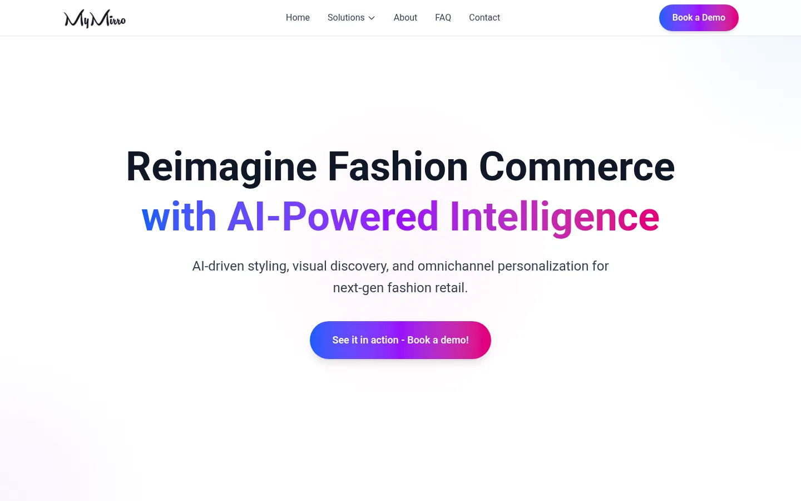
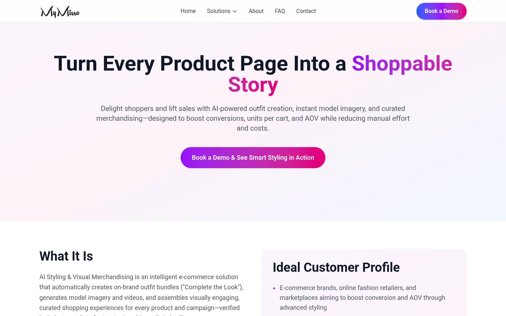

# MyMirro Labs website · [live](https://my-mirro-labs.vercel.app)

A B2B marketing site for MyMirro Labs' AI fashion-commerce platform. It has a home page, five solution pillar pages, an about page, an FAQ and a working contact form.

<table><tr>
<td width="50%"></td>
<td width="50%"></td>
</tr><tr><td align="center"><sub>Home</sub></td><td align="center"><sub>AI Styling pillar page</sub></td></tr></table>

## Features
- App Router pages: Home, About, FAQ, Contact, and pillar pages for AI Styling, Catalog Intelligence, Personalized Shopping, Omnichannel and Phygital
- Reusable sections: Hero, PillarCards, HowItWorks, ValueProposition, Proof, CTA, Navbar, Footer
- Framer Motion animations and a responsive Tailwind layout
- Contact form posts to a `/api/contact` route handler, which sends email through **Resend**

## Tech stack
Next.js 15 · React 19 · TypeScript · Tailwind CSS · Framer Motion · Resend · lucide-react · Vercel

## Run locally
```bash
npm install
echo "RESEND_API_KEY=..." > .env.local   # see EMAIL_SETUP_GUIDE.md
npm run dev
```
